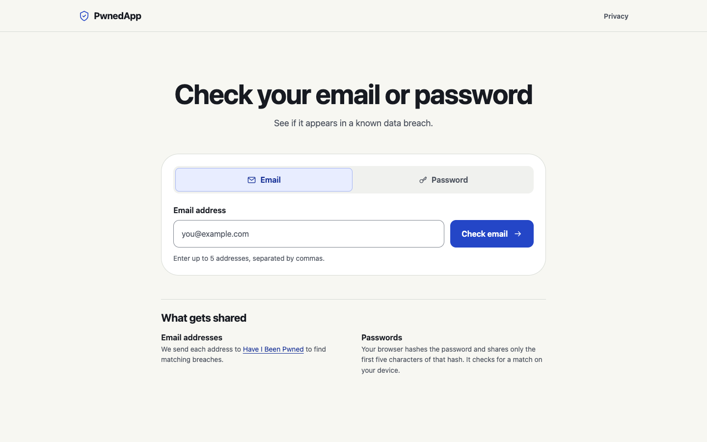
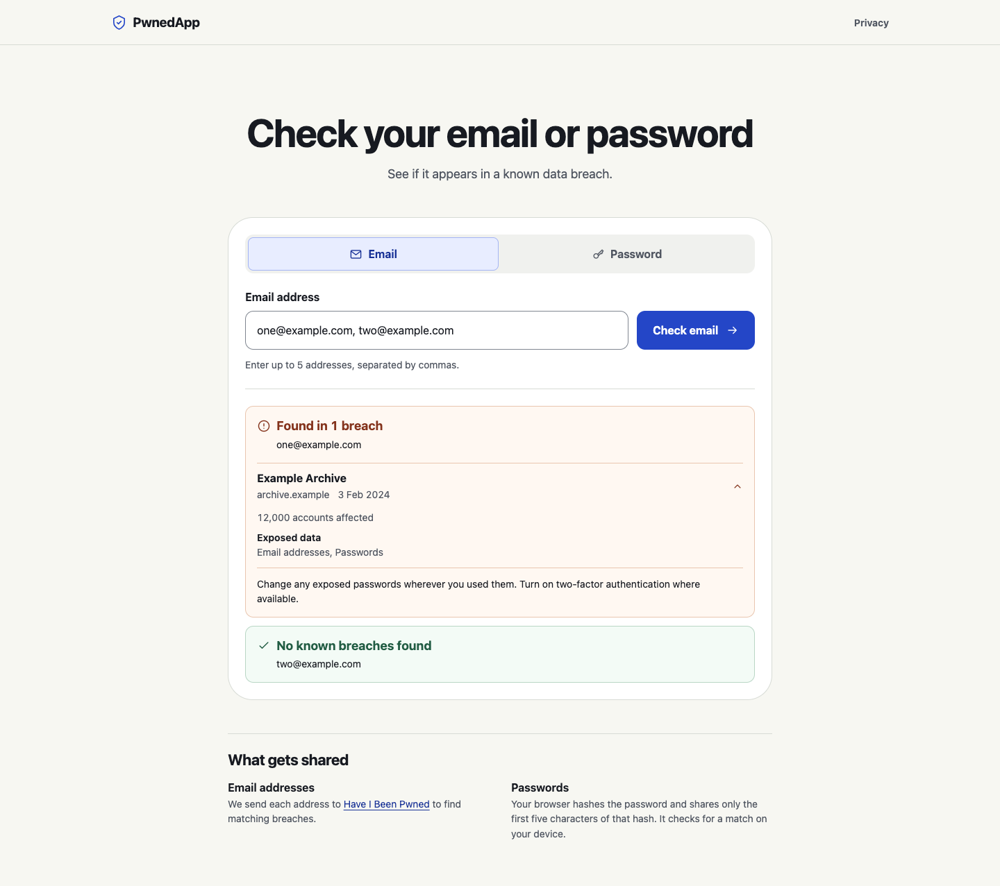
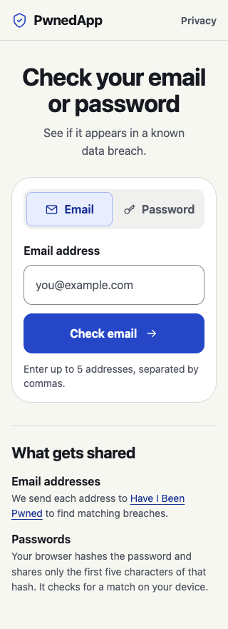

# PwnedApp

Check whether an email address or password appears in known data breaches. Email checks show affected services and exposed data categories. Password checks hash the input in the browser and send only the first five SHA-1 characters to look up a padded range of possible matches. The browser compares the suffix locally.

## Screenshots



| Breach results with sample data | Mobile checker |
| --- | --- |
|  |  |

## Run locally

Use Node.js 24 (or Node.js 22.12+) and npm. The repository uses npm workspaces with a single lockfile.

```sh
npm ci
npm run dev
```

Open [localhost:3000](http://localhost:3000). Vite proxies `/api` to the TypeScript server on port 4000.

Password checks work without a key. For email checks, copy `.env.example` to `.env` in the repository root and set `HIBP_API_KEY` to a [Have I Been Pwned subscription key](https://haveibeenpwned.com/API/Key). Restart the app after changing the file. You can also set `HIBP_API_KEY` and `PORT` in the server environment. Keep the key server-side.

To try email lookups without a subscription, use the public test key `00000000000000000000000000000000` with a documented test address such as `account-exists@hibp-integration-tests.com`. [Have I Been Pwned API documentation](https://haveibeenpwned.com/API/v3#TestEmailAddresses)

## Build and run

```sh
npm run build
npm start
```

The API serves the built frontend and API together at [127.0.0.1:4000](http://127.0.0.1:4000) by default. Set `HOST` to change the bind address in production. Use HTTPS when hosting the app so browsers can access Web Crypto. Email lookups send the address to Have I Been Pwned. If you expose the app publicly with a subscription key, protect the email endpoint with access controls and request limits appropriate to your plan.

## Verify changes

```sh
npm run typecheck
npm test
npm run build
```

Tests use simulated upstream responses and run without external credentials.
